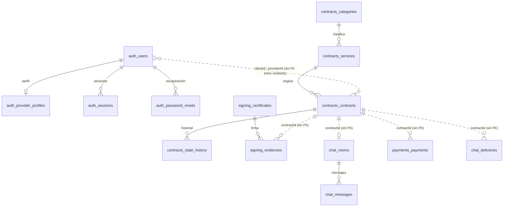

# Esquema de base de datos (PostgreSQL + Prisma)

Fuente de verdad: `prisma/schema.prisma`. Migración inicial escrita a mano en `prisma/migrations/20261101000000_init/migration.sql` (incluye el trigger de inmutabilidad). Cada prefijo de tabla es un módulo.

Las líneas punteadas son referencias **lógicas** entre módulos: no hay llave foránea, así que separar las bases en el Bimestre 2 no rompe nada.

## Tablas por módulo

### Autenticación (`auth_*`)
| Tabla | Campos principales | Notas |
|---|---|---|
| `auth_users` | id, email (único), name, phone, passwordHash (bcrypt), role (`CLIENTE`/`PROVEEDOR`/`ADMIN_SISTEMA`), status, failedLoginCount | El rol por defecto es Cliente (RS-41) |
| `auth_provider_profiles` | userId (único), tradeName, description, contactEmail, contactPhone | Perfil profesional (RF-09) |
| `auth_sessions` | userId, tokenHash (único), csrfToken, expiresAt, revokedAt | El token en claro solo vive en la cookie |
| `auth_password_resets` | userId, tokenHash (único), expiresAt, usedAt | Un solo uso y caducidad (RS-03, RS-42) |

### Contratos (`contracts_*`)
| Tabla | Campos principales | Notas |
|---|---|---|
| `contracts_categories` | name, slug (únicos) | |
| `contracts_services` | providerId, categoryId, title, description, priceCents, deliveryDays, status | Índices: (status, categoría), (status, precio), proveedor, título |
| `contracts_templates` | version (única), body, active | Plantilla con marcadores `{{…}}` |
| `contracts_contracts` | text, **textHash (SHA-256)**, partes (id, nombre, correo), totalCents, anticipoCents, saldoCents, status | Trigger: texto, hash, montos y partes **inmutables**; estado solo avanza de 1 en 1 |
| `contracts_state_history` | contractId, fromStatus, toStatus, actorId, reason | Una fila por transición |

Estados: `GENERADO → FIRMADO_PARCIAL → VIGENTE → ANTICIPO_PAGADO → CONTENIDO_ENTREGADO → CONTENIDO_APROBADO → COMPLETADO`.

### Firma y CA (`signing_*`)
| Tabla | Campos principales | Notas |
|---|---|---|
| `signing_certificates` | serial (único), userId, subject, publicKeySpki, pem, notBefore/notAfter, status | Emitido por la CA emisora; vigencia 365 días; máx. 5 activos por usuario |
| `signing_nonces` | nonce (único), userId, purpose, contractId, subject, expiresAt, consumedAt | Un solo uso, TTL de 5 minutos (anti-repetición) |
| `signing_evidences` | contractId, event, kind (`ORIGEN`/`RECEPCION`), ref, actorId, certificateId, subjectHash, payload, signature, timestampUtc, timestampToken, recordHash | Único `(contractId, event, kind, ref)`. El sello lo firma la CA emisora |

Eventos: `FIRMA_CLIENTE`, `FIRMA_PROVEEDOR`, `PAGO`, `ENTREGA_CONTENIDO`, `APROBACION_CONTENIDO`.

### Pagos (`payments_payments`)
Único `(contractId, tranche)` con tramo `ANTICIPO` o `SALDO`. Guarda monto (calculado desde el contrato), referencia propia única `INT-{contrato}-{tramo}`, ids de orden y captura de PayPal, estado (`CREADA`, `PENDIENTE`, `CAPTURADA`, `FALLIDA`), recibo (JSON, con liquidación `PENDIENTE_DE_LIQUIDACION`), `integrityHash` y el intento.

### Chat y entrega (`chat_*`)
| Tabla | Notas |
|---|---|
| `chat_rooms` | `GENERAL` o `CONTRATO` (única por contrato) |
| `chat_messages` | texto ya saneado; índice (sala, fecha) |
| `chat_deliveries` | versión, nombre, MIME, tamaño, **sha256**, clave de almacenamiento; único `(contrato, versión)` |
| `chat_notifications` | tipo, título, cuerpo (sin texto del contrato), leída o no |
